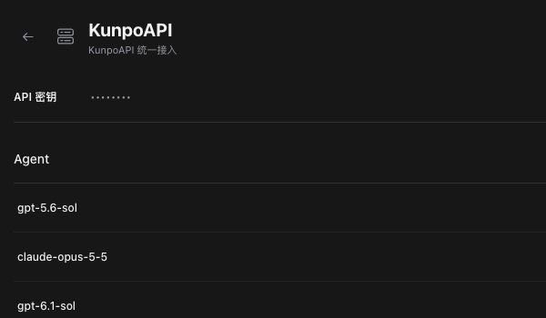

# Kunpo 本地适配交付（2026-10-28）

后续全仓检查、启动项与真实桌面/VM验收见 [人工验收前检查](pre-acceptance-check.md)。本文保留此前适配批次的历史证据，不把旧统计相加。

基线提交：`42d7e21e396d9adef7a79081416d9cf3b1a97663`，本地未提交修改。此文记录本批模型列表与适配实现，不代表原版发行包或真实 Kunpo 服务已验收。无需原作者账号；作者 Cloud、Community、遥测、更新和上传链路继续退役。

## 已付费素材的恢复

规划与执行时，主 Agent 都可以调用只读工具 `list_media_capabilities` 核对当前项目的媒体模型、默认选择和参数。需要联网才能更新的模型目录会标注查询状态；该工具不检查余额、提交生成或更改项目配置。指定的音频模型不可用时，可按提示使用目录里的服务商和模型 ID，或在项目已有适用默认值时省略覆盖项。

Agent 的直接生成工具会在可恢复的失败中给出原调用编号。用 `recover_media` 传入原工具名和 `recoverCallId`，即可在原会话中续办。恢复需要的参考文件或服务商配置有变化时，应先还原对应输入。支持的图片结果只下载原图，视频及 3D 工作流只查询、下载已记录的任务；恢复 3D 动画不会启动未提交的收费阶段。已经下载并保存在本地的完整结果可重新写入项目。

新建画布任务时，`generate_canvas_media` 只接收 `boardId` 和 `nodeId`，生成设置取自已保存的节点。恢复画布任务使用 `recover_canvas_media` 并指定原任务的 `recoverJobId`。空值、字符串 `"null"` 和 `"new"` 都不能充当编号。找不到原记录时先查会话或节点历史，另起收费任务需要用户确认。

同一会话内同类素材仍有未解决请求时，改写提示词、换调用编号或改走素材画布均不能直接重新付费。需要新生成时由用户确认。画布在同一节点上提供恢复或重新付费的选择，重开后仍核对原任务。语音、音色样音、音效和音乐接收同步音频；未收到完整文件且上游没有查询编号时，应先查账，无法凭本地编号重新取得丢失的字节。

图片工具一次生成多张时，部分失败的任务会保留已经取得的图片。恢复时沿用原任务的文件，只下载其余有结果记录的图片；没有结果记录的位置保持缺失。

恢复能否成功取决于上游是否仍提供原产物，以及本地文件是否完整。不同项目或会话的独立创作不按提示词相似度合并。这些行为使用离线模拟验证，历史扣费以服务商账单为准。

## 模型列表与默认

设置中的 Meshy、Hyper3D、Tripo、火山方舟、BytePlus 和 MiniMax（国内、国际）旧独立密钥入口已停用。“模型”页只列出实际存有旧密钥的连接，可逐项清除。历史密钥不会启用模型。Meshy 的所有可识别调用（包括旧自定义 Meshy 协议／ID／endpoint、轮询、远程恢复及下载）均已停用；旧资产、任务和回执保留；只有已持久 ToolRun／runId 的本地产物按原工具／context、权限和完整性检查交付，task／receipt 本身不允许远程恢复，缺失缓存不保证找回，也不自动改成别的服务商。Kunpo Tripo、Seedance 和 MiniMax H3 使用统一 KunpoAPI 密钥；其他受支持的自定义服务商沿用自己的配置。

设置中的 KunpoAPI 使用一个由 daemon 保存的字面量 Key；项目设计区右上角“默认模型”按工作角色选择，节点可以显式覆盖。新项目保存下表默认，旧项目/既有选择不回填、不暗换。项目重开及导出导入保留选择。型号是 Kunpo 路由名，不保证底层权重或账号实际权限。

| 角色 | 新项目首选 | 已提供适配的其他选择 | 当前边界 |
| --- | --- | --- | --- |
| Agent | `gpt-5.6-sol` | `claude-opus-5-5`、`gpt-6.1-sol` | 分别为 Chat、Messages、Responses；6.1 模型支持视觉，此 Kunpo 连接的图片协议待确认，暂未启用，详见下文 |
| 图片 | `gpt-image-2.5-sunburst` | `gpt-image-2.5-flare`、`gpt-image-2.6-sunburst`、`gpt-image-2.6-flare`、`Image-GI2.1` | 2.6 支持静态图片、文字生成 SVG、GIF 动画以及标注编辑 |
| 视频 | `doubao-seedance-2-5-260628` | `tencent-vod-vs-2.5`、`minimax-video-h3` | Native Seedance 与 Videos API 分开建任务/续查/下载 |
| 音效 | `seed-audio-1.0` | `seed-audio-1.0-multilingual` | 同步二进制 MP3/WAV，非流式；时长提示不是精确保证 |
| 角色配音 | `seed-audio-1.0`（候选） | multilingual | 支持音色节点样音、上传 MP3/WAV 参考或无参考；精确朗读、音色稳定及字幕未验证 |
| 音乐 | 无默认 | SeedAudio 短环境音乐候选 | 不承诺完整 BGM、歌词或无缝循环 |
| 3D 生成 | `v3.1-20260211` | `P1-20260311`、`P2-20260801` | 低模分支与通用几何按需选，不自动串跑全部工序 |
| 3D 减面 | `v3.0` | — | smart_uv；四边面保留 FBX 原件，另存三角化 GLB 预览；转换不支持时仍保留原件，可本地重建预览，见 [3D 文件契约](3d-providers.md) |
| 3D 绑骨 | `v3.0-20260909` | `v2.5-20260210` | 非人形按兼容版本；内置 retarget 用 tripo spec，最多 5 个动作 |
| 3D 重贴图 | `v3.5-20260815` | `v3.0-20250812`、`v2.5-20250123` | 可选工序；已有贴图合适时无需再次调用 |

`gemini-3.8-flash`、`claude-sonnet-5-5`、`kimi-k3.1-pro` 保留为待接入列表项，界面禁用，后端执行拒绝；历史选择显示原值，不悄悄替换。所有已适配型号均标记“未实测”，不能把目录列表当作真实调用成功。

### GPT Image 2.6 图片与动画

在项目画布顶部打开「默认模型」，在「图片」中选择 Sunburst 或 Flare，主 Agent 会沿用项目选择。单个画布图片节点也可以单独指定型号。使用自定义启用列表时，需要在图片连接中启用对应的模型 ID。

- 静态图片可选 PNG、JPEG、WebP。PNG 和 WebP 支持透明背景。JPEG 和 WebP 可设置 0–100 的压缩质量。编辑可使用最多 16 张静态参考图。可选的蒙版和标注层二选一，标注层使用与第一张参考图同尺寸的透明 PNG。
- SVG 每次从文字生成一张矢量图。默认作者为 `gpt-6-sol`，作者规划为 `low`。带参考图的节点需移除参考图或选择位图格式。作者访问权限由 Kunpo 账号决定。
- GIF 支持文字或静态参考图。方形默认每帧 512×512，共 9 帧，每帧 200 毫秒。可以指定每帧尺寸、2–16 帧及 20–2000 毫秒。高画质沿用所选尺寸。
- SVG 和 GIF 原件按原格式保存。生成中断后，使用原任务的恢复入口可取回已保留的结果。服务商未返回可恢复结果时，需要用户决定是否重新生成。

## 本批行为与限制

### 2026-11-08 GPT-6.1 Sol 图片能力与连接策略

[OpenAI 官方模型页](https://developers.openai.com/api/docs/models/gpt-6.1-sol)明确列出 `gpt-6.1-sol` 支持图片输入，工具调用使用 Responses。此前本地把“尚未确认 Kunpo 路由图片协议”写成 `capabilities.images: false`，这个标记不能作为模型不支持图片的证据。现已把模型能力标为支持图片，并单独记录 `imageInputStatus: unverified`。

本工具的实际路由是 `POST https://llm.ziy.cc/v1/responses`，不是 OpenAI 原厂端点，也不是 Chat Completions。[Kunpo 模型专页](https://docs.ziy.cc/api-reference/gpt-6-1-sol/)当前给出文本、SSE 和函数工具续接示例，未给出此路由的图片输入或带图片工具结果契约；不能从文档未举例推断不支持，也不能把原厂能力当作网关实测。当前 `supportsImages: false` 仅表示这条配置连接未启用图片，保留用户已有配置，不自动放开或覆盖。模型菜单使用实际连接能力，已有图片的会话或草稿会在切换前提示；服务端在保存模型选择前再次检查当前上下文，拒绝时不更改原选择或发出模型请求。

无付费模拟测试覆盖标准 Responses 的用户 `input_image`、工具 `function_call_output.output` 内的 `input_text`/`input_image` 数组及 Base64 data URL，并确认图片没有退化为文字占位符。这验证本地 SDK 的构造能力，不验证 Kunpo 接受、底层路由或识图质量。进一步启用需要网关的明确协议证据或另行授权的真实验收；本批不调用模型或产生费用。

### 2026-10-31 图片模型输入按来源分流

Seedance 2.5、H3、VS 2.5 的普通参考、单首帧和首尾帧现在逐张选择传输方式，可混合使用：

- 由本工具通过 Kunpo 图片接口取得的原始 CDN 结果，在下载校验后，将 URL 与该次下载的完整字节 SHA-256、长度绑定；只对当前读取的文件仍完全相同且来源可验证的资产直接传 URL。节点换图、重新生图、工作区修改或同长度改写都不会继续沿用旧图链接；改名不改变内容绑定。
- 用户导入、修改后的图片、旧资产缺少可靠绑定、来源记录缺失/损坏/权限不安全，或 CDN 的公网 DNS 检查不通过时，使用当前本地文件，沿用此前的 PNG/JPEG 派生与 Base64 链路。本轮没有新增图床上传接口，也不根据文件名、`origin: generated` 或相同像素猜测来源。历史已完成图片不会被批量补造链接；旧图片结果恢复后重新下载校验的产物可建立新绑定。
- 仅接受 Kunpo 控制面 `https://llm.ziy.cc` 返回并已成功下载的精确图片 CDN `https://kunpoapiimg.ziy.cc`，不接受任意远程 URL、用户名/密码、已知凭据或片段。URL 只发回 Kunpo 控制面，不携 API Key 访问 CDN。仍保留 DNS/私网、重定向和大小检查；URL 输入不代表绕过模型自己的图片尺寸、格式和可达性限制。
- 绑定保存在 daemon 数据目录 `library/provider-image-sources/`（目录 0700、记录 0600、原子替换），不进入 Library 公共元数据、画布、公共任务输入/历史、原始会话上下文或项目导出；该目录也加入私有路径策略。选用 URL 时仅在发往 Kunpo 的请求投影中加入，不改原会话。可选绑定写入失败不丢弃已经获得的图片，回退本地文件。视频和图片的公共产物仅记录 URL/本地输入数量等封闭数值。Tripo 原有私有恢复日志会保留已经选择的 URL 或文件 token（0600），供续查重建原请求身份，不在公共产物中返回。重新导入的项目不携私有 URL 能力。
- 恢复指纹继续使用原本地素材及原参数，新传输选择仅发生在首次提交分支。旧任务不补标、不改快照；已有 ID 只查询原任务，未知无 ID 不自动重发。URL 请求被拒绝后不会自动改成 Base64 再提交，避免重复收费。CDN 的“永久”来自公开服务契约；本工具的字节校验确认本地内容版本，并不逐次证明远端 CDN 此后从未变化。

本轮只做自建素材、假 Key、模拟 HTTP/DNS 验证，未上传用户素材、读取真实 Key 或调用模型，没有重启用户实例或变更网络。没有改 UI，现有控件和错误/续查交互保持原样。运行中的旧版本需用户自行正常退出后启动才会加载新代码；请勿中断未保存或正在提交的任务。URL 传输仍待单独授权的真实上游验证，不能据此保证不再出现 HTTP 400，也没有证实所谓 1 MiB 上游硬限额。

当前源码入口盘点（同一规则包含批量、重开与重试，不把“全部盘点”说成“所有协议都改用 URL”）：

| 模型输入入口 | 当前处理与证据入口 |
| --- | --- |
| 素材/游戏设计画布视频；Agent `generate_video`；直接视频工具 API | Seedance、H3、VS 普通参考/单首帧/首尾帧逐图选择 URL 或当前本地编码；`kunpo-video-provider.ts`、`tools.ts`。21 组画布来源/模式组合覆盖三模型，保留旧指纹和无 ID 防重发。 |
| 画布图生图；Agent `generate_image`；直接图片工具 API | Sunburst/Flare 无 mask 编辑在有可信 URL 时使用 JSON `images`，混合本地 data URL；无可信来源时保留 multipart。GI2.1 按其 JSON/MIME 契约混合 URL/data URL。`openai-image.ts`、`agent-tools.ts`、`canvas-workspace.ts`。 |
| 图像 mask | 保留已验证的 multipart 原图和 PNG mask 字节，不猜测 JSON mask 契约，不把蒙版图替换成远程链接。接口流程模拟通过不等于真实局部重绘语义验收。 |
| 画布/Agent/直接 API 的 Tripo 单图、多视角、参考图重贴图 | 同一私有上传阶段可选择可信图片 URL；用户本地图片继续原文件上传取 token，GLB 源模型上传不变。URL/token 选择按原字节指纹持久化，重开只重用原值，不因来源变化新增上传或收费阶段。`tripo-provider.ts`、`model3d-journal.ts`。 |
| 画布图片生成文本、Markdown 文档 | 从当前画布文件解析来源，完整字节复核；Chat Completions 在真实 Pi SDK 的 `onPayload` 中替换对应图片字段，按出现顺序区分相同字节但不同来源的图片，不改会话上下文。`canvas-text-references.ts`、`text-generation.ts`、`model-network-policy.ts`、`local-model-runtime.ts`。实际画布→SDK→假上游的两个入口通过。 |
| 主 Agent 的图片、跟进/排队/历史 | 对应用已知资产 ID，使用 Pi 公开 `appendCustomEntry` 保存紧邻实际用户消息的来源回执，仅含消息摘要与逐图资产 ID；完整核对规范化后 MIME、字节、顺序和数量，重开后再按消息 ID 与当前字节恢复来源。跟进、排队转立即执行、移除排队及修改上一条消息均覆盖；不改 SDK、用户消息或依赖。普通文件选择器/附件仍属于本地上传，不从相同像素猜来源；无回执的旧历史、绕开应用管理的裸 SDK 会话和规范化改变过的图片安全内嵌。`agent.ts`、`session-images.ts`、`app.ts`。 |
| `game_use` 截图、`recall_image`、图片历史预览/缩小 | 截图保持本地内嵌；`recall_image` 可从原会话消息恢复其已验证资产线索。缩放/转码后字节不匹配、来源记录缺失或 DNS 不安全时仍内嵌。会话历史与预览预算机制继续有效，文字模型的视觉拒绝规则不变。`playtest-tools.ts`、`session-images.ts`、`session-image-requests.ts`。 |
| Opus Messages 与 GPT-6.1 Responses | 仅精确型号 `claude-opus-5-5` 的原生 Messages 接通已验证来源的 `source: {type: "url", url}`，包括工具返回中的图片；其余图片仍 Base64。保留思考签名、工具续接和原会话，模拟验证不等于 Kunpo 实际 URL 读取验收。其他未审核 Messages 型号不套用。6.1 没有已验证视觉契约，仍在发送前拒绝图片/截图，不由 CDN 规则绕过。 |
| 其他图像/视频/3D 协议适配器（Seedream、OpenRouter、Gemini、旧 MiniMax、Hyper3D） | 不能仅因有相似字段就套用 URL；保留其已有 data URL、inlineData 或文件 token 形式。原厂网络入口与未接入候选仍受既有安全/能力策略限制，loopback 协议夹具不是正式支持或真实上游证明。 |
| Meshy 历史协议／任务 | 已停用全部可识别调用及远程恢复；不套用 URL、不下载或重新提交。本地资产和回执保留，历史协议夹具不代表当前功能可用。 |
| 原生 CLI 图片/Agent、DeepSeek Files、Cloud/插件旁路 | 维持既有退役/禁用或端点拒绝，不为使用图片 URL 恢复外部执行、原作者服务或未审核文件上传。`agent-runtimes/*`、`deepseek-image-files.ts`、`model-network-policy.ts`。 |
| 不属于模型图片输入的路径 | 项目封面、缩略图、画布导入/导出、原图查看及本地 PNG/JPEG 处理不因此上传；配音/音效参考为音频，3D 绑骨/动画主体为模型文件，不套图片 URL 策略。纯文本表格/项目命名不会自动抓取图像。 |

来源线索只是本地 `libraryAssetId`；仅带这个字段、`origin: generated`、显示 URL 或相同文件名都不能取得 URL 能力。主 Agent 的私有来源回执不保存图片正文、提示词、URL 或 Key；消息内容、时间、顺序或回执格式发生变化时不恢复旧来源。最终仍须通过私有资产来源记录和完整字节校验。已有任务原样恢复；转换过的 WebP/预览图若不再匹配完整字节，仍走当前本地内容。Responses 视觉、JSON mask 和未审核协议保持原安全限制。若 Opus 历史图片因来源/DNS 不可用而回退内嵌，线上签名/历史接受行为未实测；拒绝后不会自动重发收费请求。

契约：[GPT Image 编辑](https://docs.ziy.cc/api-reference/image-generation/models/gpt-image-series/)、[GI2.1 参考图](https://docs.ziy.cc/api-reference/image-generation/models/nano-banana-series/)、[Tripo 单/多图与贴图](https://docs.ziy.cc/api-reference/tripo-3d/)、[Chat 视觉输入](https://docs.ziy.cc/api-reference/text-chat/)。[Kunpo Messages](https://docs.ziy.cc/api-reference/claude-messages/) 声明原生 Anthropic 协议，[Opus 型号页](https://docs.ziy.cc/api-reference/claude-opus-55/) 确认图片输入；[Anthropic 视觉文档](https://platform.claude.com/docs/en/build-with-claude/vision) 明确原生 URL source。后者是接通依据，不是 Kunpo 代理已实测兼容的证明。URL 减少的是上游请求内的图片编码体积，不消除模型自己的图片数量、尺寸、网络可达性与计费限制。

前一批回归：25 个选定测试文件、798 项通过、0 失败、0 跳过，未重跑整仓。覆盖实际画布 API→ToolRunner/SDK→模拟上游的七类跨功能路径；三模型视频来源/模式组合；源文件修改、同长度改写、节点替换、重开、混合相同字节的不同来源；私有记录的缺失/损坏/链接/权限；无 ID 未知、旧任务、取消、并发和纯续查。两项旧 3D 测试原先期待另一个恢复实例能继续创建收费阶段，现更新为明确拒绝，保留原实例继续与其他实例只读复用的验证，没有放宽防重复收费规则。当时主 Agent 仅验证安全内嵌回退；后续来源回执与 Opus URL 接通补验另记，不能混算旧证据。

类型检查、host TypeScript 编译、renderer 构建、新文件格式检查和 `git diff --check` 通过；构建写入 `/tmp/ohmygame-image-source-check/`，保留原有大 chunk 警告，没有替换用户运行中的 `dist`。最终日志为该目录的 `complete-final.log`、`complete-types.log`、`complete-host.log`、`complete-renderer.log`。临时测试服务器及测试进程已退出；本轮未启动产品服务、Electron 或 VM，未安装新依赖，未 commit/push/打包。没有更改界面，未冒称新的 Computer Use 或真实模型验收。

后续主 Agent/Opus 补验：同一组 25 个测试文件共 808 项通过、0 失败、0 跳过；类型检查、host 编译、renderer 构建与 `git diff --check` 通过。新增实际 HTTP 入口→默认应用 runtime→Pi SDK 的 GPT-5.6/Opus 两轮来源验证；实际持久会话重开、排队转立即执行、移除排队、修改上一条消息；同图不同来源、消息/来源回执篡改、召回原图；Opus 带签名思考与图片工具结果续接。808 是本次选定范围，不是全仓总数，也不与旧 798 相加。HTTP 夹具在最终类型修正后另复测 2 项通过，其筛选排除项不计入 808。日志为 `/tmp/ohmygame-image-source-check/origin-final-regression.log`、`origin-final-types.log`、`origin-final-host.log`、`origin-final-renderer.log`、`origin-final-diff.log`、`agent-http-final.log`。本补验同样未使用真实 Key、上传素材、调用模型、重启用户实例或替换运行中的构建；测试进程已退出。

### 2026-10-31 视频本地参考图的请求总量处理

三模型 Seedance 2.5、H3、VS 2.5 的普通参考、单首帧和首尾帧共用同一新任务准备入口，包含画布、Agent 工具和直接视频工具 API。来源可验证的 Kunpo CDN 图仍直接传 URL；其余本地 PNG/JPEG/WebP 不新增上传，按实际文件处理。图片编辑、mask、3D 与图生文不套用此有损策略。

- 本地完整 JSON 请求目标为 **768KiB（786,432 字节）**，包含文本、协议字段、CDN URL、Base64 和全部参考。它是应用策略，不是已证实的 Kunpo 限额或成功保证；此前 773,385 字节的质量92双图成功样本只是有限依据。没有新增环境变量、密钥配置或设置控件来改变该目标，策略常量在 `video-reference-budget.ts`。
- PNG 先走既有无损优化及有条件的质量95 JPEG 派生。完整请求仍超标时，本地 PNG、上传 JPEG/WebP 按统一档位尝试 JPEG：先质量95→92→90，最长边上限2048；再保持质量90，按1536→1024→768→512→384→256逐档缩小。每档从安全验证过的原内容派生，不连续重压前一张 JPEG；保持比例、不裁剪、不放大，仅实际编码更小时采用。单张图短边不降到256以下（原图本来更小则不低于原短边）。已有 JPEG/WebP 在请求达标时不重压。
- 透明/alpha、动画、多页、高位深/HDR、不确定色彩或无法安全解码的素材不强行转 JPEG，不选取单帧、不合成背景；PNG 仍可使用通过完整校验的无损副本。ICC 转到 sRGB、EXIF 朝向落实为像素，派生不带原 EXIF 文本。JPEG/WebP 重编码与缩小会损失信息，质量值不代表原素材质量得到提高。所有原文件均保留，副本仅在内存中。
- 整个准备过程沿用15秒总预算，单次编解码最多约5秒、JPEG 最多8M像素及单工作名额，最多9档。原始单文件30MiB、合计64MiB边界仍保留；这些是本地资源保护。无法在这些边界内达到目标时，**提交前停止，不发送生成 POST**，既有错误位置提示减少参考或换较小的不透明图；可手动调整后再操作，不提供自动付费重试。
- V3 封闭摘要在 POST 前保存实际完整请求字节、目标是否达到、档数、额外派生/缩小数量及最低采用质量/最长边档位；不含图片、URL、提示词、路径或 Key。PNG 初始准备与总量补处理分别计数。缩小反馈复用原有提示区域，无新原生控件或说明栏。旧 V1/V2 记录仍可读取，原始任务指纹不加入新策略、不重写旧任务；恢复有 ID 只 GET，无 ID 未知仍拒绝重发，URL 拒绝也不自动换编码重提。

本批最终代码验证：26 个选定文件、**871 项通过，0 失败、0 跳过**；类型检查、host 编译、renderer 构建、相关新模块格式与 `git diff --check` 通过，仍有原有大 chunk 提示，未重跑整仓。包含三模型×三参考模式的预算/混合来源、完整画布、直接 HTTP 工具入口、Agent `generate_video` 实际执行链；JPEG/WebP/PNG、EXIF/ICC、动画/透明、字节与尺寸保底、同尺寸画质差异检查、超标未提交、取消、HTTP400/500、缺 ID、旧任务与重启只续查，以及现有反馈组件的40项自动化检查。日志为 `/tmp/ohmygame-image-source-check/budget-final-regression.log`、`budget-final-types.log`、`budget-final-host.log`、`budget-final-renderer.log`、`budget-format.log`、`budget-final-diff.log`。871 是本批选定范围，不与旧统计相加。

全部为自建素材、假 Key、模拟 HTTP/DNS 与既有临时 loopback 测试；没有读取根 `.env`/真实 Key、真实生成或上传、操作用户实例/素材、启动 Electron/VM、新增依赖或修改网络。组件自动化不冒称新 Computer Use 实机验收；同尺寸 PSNR 检查也不代表上游视频画质。构建仅写 `/tmp`，测试进程已退出，未替换运行中的 `dist`，未 commit/push/打包。用户正常退出再启动后加载；请先完成正在提交的任务并保存。固定目标可能拒绝上游本可接受的请求，很多复杂图片、透明图或时间/资源受限时仍可能无法达标；需减少参考或手工准备较小副本。新自适应策略与三模型真实接受情况仍待单独授权，不能保证解决所有 HTTP400。

### 原适配批次记录

- 复用现有深色样式、自定义弹层/选择器和设计 tokens。模型切换校验能力并提示重置不兼容参数，服务端同样校验。没有新增原生 select/dialog/alert。
- 图片移除固定 medium/webp。输入 32MiB、输出 64MiB、最长约 16 分钟；同步提交先落恢复记录。结果未知不自动重发收费 POST；已有可用 URL 只重新下载，inline 结果崩溃后不可凭空恢复。
- 视频保存实际协议、任务 ID、参数；重试续查同一任务。每个模型分别检查尺寸/时长/参考模式。最长等待 15 分钟，输出 256MiB；未知状态和网络失败有次数上限。本轮未接通本地视频参考、编辑/延长、VS/H3 本地音频参考；Seedance 音频输入适配器具备但界面入口未完整提供。
- 2026-10-30 当前视频输入策略：Seedance/VS/H3 的普通参考、单首帧、首尾帧共用新任务准备流程。PNG 先尝试仅重压缩 IDAT：采样流和其他块（含 alpha、ICC/色彩、EXIF）不变且确实更小才使用无损副本。无损阶段后仍超过 512KiB 或最长边超过 2048 的不透明 PNG，可生成质量 95、4:4:4、最长边 2048、保持比例且不放大的 JPEG 有损副本；只有含 MIME 前缀的 Base64 输入也更小时才使用。512KiB 是本地尝试派生的触发值，不是上游限额或必须达到的大小；不通过降低质量循环“凑阈值”。原 PNG、草稿和用户 JPEG/WebP 输入不改写，派生只存在内存中。
- JPEG 在 daemon 内用既已锁定的 Sharp 0.35.5 处理，不采用浏览器原生控件或复制其他项目代码。EXIF 朝向落到像素后移除旧方向，ICC 管理转换到 sRGB，并附 sRGB profile；JPEG 不保留原 EXIF/文本等元数据，也不承诺像素或色彩数值无损。alpha/tRNS 通道、动画、未知结构、高位深/HDR、不确定的 PNG gamma/色彩、解码异常或资源受限时保留 PNG，不合成背景、不裁剪；既有按钮提示和错误位置说明所用副本或回退。先前只处理 PNG 的策略不再代表全部当前行为，现有 JPEG/WebP 在完整请求超标时也可生成派生副本，以上一节总量策略为准。新策略的参考画质与上游接受情况仍需单独授权实测。
- 本地保护：无损阶段最多 4096 个块、解压扫描线 32MiB；JPEG 输入最多 8M 像素。两种编解码各最多一个工作，单阶段最多约 5 秒，任务准备总预算 15 秒。JPEG 取消先阻止提交，原生工作结束前不释放其并发名额；这是应用内限制，不是 OS 资源沙箱。已有单文件 30MiB、总输入 64MiB 的前置拒绝边界继续有效。资源受限不放宽安全校验，不保证原 PNG 可被上游接受。
- 新任务按原素材构造恢复指纹，派生只在首次提交分支内执行。新 V2 摘要严格校验封闭计数、字节数、质量/尺寸常量，包含原/实际 JSON 请求字节数；不含提示词、图片、路径、Key 或 URL。实际 `CanvasWorkspace → ToolRunner.runPrepared` 入口在 POST 前将摘要落盘，保存失败则不提交；失败、取消及重开保留已完成的准备摘要。旧 V1 摘要/无摘要任务不补标、不重新编码；有 ID 只续查，无 ID 且提交未知不自动重发。提交后的取消仍不保证上游撤单或退款。
- 本轮实际画布接通及 JPEG 回归：选定 11 个文件共 341 项通过、0 跳过；类型检查、daemon 编译、renderer 构建及 `git diff --check` 通过，保留已有大 chunk 警告。覆盖真实画布 API 到模拟 provider 的三模型×普通参考/单首帧/首尾帧、摘要先落盘、失败/取消/旧任务续查和隐私。早先 207 项未覆盖实际画布 `runPrepared` 摘要回调，不能将那批证据视作此入口已通过。浏览器仅验原 `VideoNode`/CSS 隔离夹具的浅深主题、宽窄可达和既有反馈/恢复/取消；不是完整用户实例或真实上游验收。日志位于 `/tmp/ohmygame-canvas-png-fix-A0Givj/`。本轮没有读取真实 Key、使用用户素材或追加真实模型请求；未重启用户实例。截图仅在工具输出显示，未保存文件。
- VS/H3 的画布 UI 仅有生成入口，没有可点击的视频编辑/延长生成操作。`VideoNode`（`asset-canvas-workspace.tsx`）只渲染生成按钮；`saveTrimmedVideoNode`/`VideoTrimmer` 属于本地人工裁剪，继续保留，不等同调用模型编辑/延长。
- SeedAudio 为 Bearer `/v1/audio/speech`，音色节点用独立描述与可编辑样文生成候选，试听/选用/连接不收费、不创建永久 Speaker ID。配音参考可选；选定的本地参考音频以原始 Base64 `references[].audio_data` 提交，MP3/WAV、不超过 30 秒和 10 MB；不再提供 Speaker ID。响应头等待（含上传）300秒、音频接收180秒、总上限480秒及64MiB，输出仅MP3/WAV；无伪造字幕/任务 ID。中断或返回结果不明持久化为 unknown，自动重试拒绝；画布再生成须明确确认未知任务对应的新收费请求。引用绑定内容版本，更新音色须手动确认。本地导入/试听不调用模型；持久音色克隆和多角色对话尚未接通。
- Tripo 处理 pending、任务恢复与产物归档接口；生成、减面、绑骨、重贴图各自保留所选版本。不支持取消的上游任务仅停止本地等待，不能承诺撤单或退款。others/avian 尚无集成的动作预设；不伪装可自动动画。
- 历史产物记录实际 model/protocol/经筛选参数/task ID。新记录不附 Key、提示词或参考文件正文；旧产物不猜填型号。项目画布/对话作为用户工作资料仍可能保存提示词。
- 模型控制面仅允许已审阅 Kunpo 路径及显式 loopback；产物下载区分同源带认证内容接口与精确 CDN `kunpoapiimg.ziy.cc` 的无 Key 下载。拒绝携 Key 跨域重定向、私网产物地址和超限响应。没有通配 CDN 放行。
- 主 Agent 收到响应头后会持续接收 SSE。只要每 180 秒内有数据或心跳到达，就会继续等待。每条响应最多 32 MiB，整条通过本地校验后再显示内容。本地空闲超时、本地校验失败和响应中断分别提示，失败后不会自动重发。HTTP 200 后发生这三种情况，上游仍可能计费，可先核对服务商用量。
- SDK 两层自动重试及缓存预热固定关闭，旧设置或调用参数不能重新启用；HTTP 503/连接中断不自动重复收费请求。用户手动重新发起 Agent 消息仍是新请求，不等于查回此前结果。
- 经明确授权，应用层现在仅对当前回合中有结构化 HTTP 500 的模型失败执行有限自动续接（5/15/45 秒，最多 3 次）。正常完成、手动停止与进程重启不触发续接；生成结果不明先恢复原任务，无法确认则停止。见 [续接边界与持久化](agent-errors.md#automatic-continuation-after-http-500)。它不修复网关内部错误，也不改变生成恢复、费用确认或 SDK 禁止重试的边界。
- GPT-6.1 仍不声明视觉能力：Composer 遇图片或会截图的上下文时阻止发送、提示切换视觉模型并保留草稿；纯文字附件可发送。后端在用户图片、工具图片及历史截图进入 SDK 前明确拒绝，不能替换成“已看图”文字占位。该会话不注册 game_use/recall_image；视觉/文字模型互换时重建会话工具列表。含图片的旧历史切到文字模型也会拒绝，须选视觉模型或开纯文字新会话。

## 验证证据

所有执行均使用独立临时 HOME/应用数据、假 Key 与模拟上游，没有调用付费模型。实际浏览器运行的是改后 daemon + 构建 renderer；本批未重启 Electron/VM，既有静态/动态 game_use 与受控 isolated_shell 的历史验收不算本批新通过项。

- 选定后端最终统一回归：17 文件、370 项通过、0 跳过；这一统计只针对明确选择的 17 个文件，不是完整仓库测试。另跑 Agent 模型切换/未完成响应 6 项目标测试，108 项因筛选未执行；UI 选择器/Composer 29 项通过，引导/设置 5 项通过（71 项因筛选未执行）。筛选未执行不计通过。TypeScript `--noEmit` 退出 0。主 renderer 与 sandbox 构建退出 0，保留现有大 chunk 警告。
- 真实 Pi SDK 的 GPT-5.6 Chat 图片编码、工具调用→结果→第二轮回答通过模拟 transport；Opus Messages signed thinking/工具续接通过。GPT-6.1 Responses 两轮 tools 已模拟验收：分别保留 function_call 的 item.id 与 call_id，toolResult 按 call_id 回传完整历史；completed、incomplete.max_output_tokens、缺失终态及取消均覆盖，且不自动重发。incomplete 保留 length 原因并在 Agent 层报告未完成，不能冒充完整回答。GPT-6.1 的用户图片/工具截图在两个 complete 入口均拒绝、fetch=0；实际会话的注册工具/历史截图边界另有测试。以上均不等于真实 Kunpo 服务验收。
- 收尾补测三种协议的 complete/completeSimple：调用者指定重试 2 次时，HTTP 503/连接中断仍只调用一次。实际会话从旧 retry/idle-warming 配置创建后强制关闭两项，不改写旧偏好文件。
- 早先 3D 管理 suite 的 6 项失败预期仍是旧独立 Key 可生成、任意远程端点可连接。现已改为明确拒绝且零 fetch 的本版安全契约，保留版本/可见/默认/重启元数据覆盖，整 suite 11/11 通过。Tripo 无统一 Key 时新默认写入明确 400；旧偏好 fixture 重启仍保留。不代表恢复 Meshy/Hyper3D 的原厂调用。
- Chrome 实际进入免原账号本地项目、创建图片节点、切换透明参数到 GI2.1，看到不兼容参数重置提示；模型默认保存重开。800 像素窄窗弹层可操作，pending 选项 `disabled=true`。Kunpo 为直接可见入口，目录只读、Key 掩码显示。
- 2026-10-28 收尾补充没有再次启动网页或 VM；新增 GPT-6.1 发送限制由实际组件交互、SDK 模拟和静态视频入口核对覆盖，不把它写成新一轮真实浏览器验收。
- 模拟图片成功产物保留；60 秒等待的另一任务取消后磁盘为 cancelled，刷新不自动重发。第一次 10 秒响应与取消发生完成竞态，未把该次算作取消成功。
- 公共接口、错误、日志/导出假 Key 边界、重定向、重复请求、未知结果、视频/3D 任务续查与模型持久化有针对测试。临时应用数据扫描仅专用凭据文件命中 UI 假 Key，权限为 0600；不是读取用户真实凭据。现有测试不证明任意编码秘密、供应商后台或所有 OS/浏览器出口都安全。

证据索引：

- 最终后端/类型检查：`/var/folders/qc/58d4jj9x3mzgmr6j4kzphy9r0000gn/T/ohmygame-kunpo-final.6_xcsre6/`（`commands.json`、`tests-addendum-final.log`、`typecheck-addendum.log`、`gpt61-model-switch.log`）。早先 `tests.log` 的 363 项统计已被本次 370 项替代，不能相加。
- 最终 UI 选择器/Composer/双构建：`/tmp/ohmygame-textonly-ui.UQUOGv/`；引导与设置最终目标测试：上方最终后端日志目录的 `ui-connections.log`。
- 实际浏览器临时应用数据、最终模拟调用记录和 canary 检查：`/tmp/ohmygame-kunpo-ui-live.BdwcSA/`。最终服务运行只记录 1 次模拟 Sunburst POST；网络函数在本进程内拦截，不能据此声称全机抓包零外联。成功图片来自前一运行批次，取消验收来自最终批次。
- 小型交付摘要：`/tmp/ohmygame-kunpo-delivery/`。模型目录局部截图也保存在仓库 `docs/assets/kunpo-model-directory.jpg`，9167 字节。截图只显示本机测试目录，Key 掩码，没有用户真实账号资料。

临时 daemon/网页服务已停止，Chrome 验收页已关闭，视口恢复默认；本批未启动 VM/Electron。manifest/lock 的三类依赖字段一致，`git diff --check` 退出 0。未新增依赖、未安装或打包、未 commit/push。真实密钥权限/质量/费用、严格 TTS、完整音乐与待接入候选必须在单独授权后验收。

Library 附件保存尚未完成：当前执行环境的上传接口不可用，未创建文件或取得文件 ID。本机报告与截图已保留，保存失败不改变源码和测试结果。

## 接续入口

### 2026-10-29 图片结果恢复修正

同步图片的已返回 URL、请求 ID 和实际参数会在 DNS/下载检查前写入 daemon 私有恢复记录（目录 0700、文件 0600；原子替换，写入前同步文件）。签名下载 URL 视为私有能力，仅保留于该记录，不返回 renderer、任务历史或产物参数，也不转发 API Key 给 CDN。用户名/密码、已知 Key、损坏记录和未审核来源均不能借恢复下载。恢复按钮和后端图片 retry 均限定为使用已有结果；缺失或提交结果未知绝不转为新 POST。

本机对官方 CDN 的当前只读 DNS 查询得到 `198.18.0.106`，属于 Fake-IP/保留地址，仍必须拒绝；旧失败时的 DNS 答案未被记录，不能确认当时相同。应用不改系统网络配置，也不放行 Fake-IP。新生成先检查文档指定的 CDN，遇此问题在模型 POST 前停止；已返回的结果则保留供网络修正后恢复。需要由用户/网络管理侧为 `kunpoapiimg.ziy.cc` 提供真实公网解析。预检查不是请求成功保证，后续每次下载仍独立校验。

修复前已经丢失 URL/请求 ID 的那次旧结果无法在本地重建；需 Kunpo 后台仍保留结果链接才可能找回，不自动重试生图。相关验证只使用假 Key 和模拟响应，不代表真实 Kunpo 下载、生成质量或计费验收已通过。 本轮 13 个相关测试文件共 270 项通过、0 失败、0 跳过；类型检查、renderer 构建和隔离浏览器恢复/取消/重开检查通过，未重跑整仓测试。

目录/默认：`src/shared/kunpo-models.ts`；统一凭据/请求边界：`local-model-runtime.ts`、`provider-network.ts`、`app.ts`；图片：`openai-image.ts`、`image-request-journal.ts`；视频：`kunpo-video-provider.ts`、`video-task-journal.ts`；音频：`kunpo-audio.ts`；3D：`tripo-provider.ts`；任务持久化：`tools.ts`、`asset-library.ts`；模型 UI：`media-model-defaults.tsx`、`asset-canvas-workspace.tsx`。daemon 文件位于 `src/daemon/`，UI 文件位于 `src/renderer/`。

协议参考：[Kunpo 文档](https://docs.ziy.cc/)、[模型广场](https://llm.ziy.cc/pricing)。两份用户提供的本机经验笔记只读使用，没有修改或复制其中凭据/配置；其中同步图片、PNG mask、空 b64/URL 优先级、长等待及不盲重试等经验已纳入实现与测试。

## 真实视频验收的恢复记录

视频失败或结果未知后，再点普通生成会先使用画布既有自定义确认界面，说明这是新任务、可能再次收费；有已保存 ID 时仍可直接选择纯续查。首次生成、已成功任务和明确未提交的本地失败不增加此确认。daemon 在实际传输调用前保存 `videoSubmission` 封闭状态；这只证明已尝试发送，不能证明供应商已受理或计费。旧历史兼容已有诊断和保存任务，不改写原任务。无 ID 的续查始终拒绝，不会转为 POST；明确选择新建则创建独立任务，原任务和未知占位保持不变，也不能承诺上次任务已取消或不会计费。界面确认不是任意 API 调用的权限隔离机制。

此项回归：5 个相关测试文件共 258 项通过、0 失败、0 跳过，类型检查及隔离输出的 renderer 构建通过（保留已有大 chunk 提示），未重跑全仓。Computer Use 在独立假任务页面核对首次/本地未提交/成功、400/未知、取消/Escape/遮罩、双击确认、已有 ID 纯续查及无 ID 不显示续查；浅深主题、1280×720 和 375×667、焦点回收和 Tab 循环通过。夹具最初漏健康检查响应和 `game-design.css`，修正夹具后完成最终界面核验；没有修改用户实例。截图仅在工具输出显示，未保存文件。日志位于 `/tmp/ohmygame-video-confirmation-fDbAYp/`，没有读取真实 Key 或调用上游；测试标签及专用静态服务已关闭。运行中的用户实例未重启，新代码需下次正常启动加载。

真实任务 ID 与诊断输出必须分开：允许恢复的付费验收应将供应商原始 ID 保存在专用测试目录的私有恢复日志（0600）中，控制台、脱敏回执和交付内容只报告是否收到 ID，不能打印 ID、Key 或签名 URL。若要求连私有日志也不得保存 ID，应在提交前澄清并停止收费测试，不能用内存别名代替产品恢复记录。

2026-10-30 09:17 UTC 的一次 JPEG 真实验收存在测试夹具设计错误：临时 `once.mts` 将提交响应里的真实 ID 替换成测试别名，再在查询时从内存映射回去。产品日志因此保存了别名，原始响应 ID 没有到达产品日志；这不是产品漏写已收到的原始 ID。进程结束后真实 ID 被清空。只读检查该次目录的 17 个 JSON 文件，仅发现一处任务 ID 字段且为别名，没有找到可本地恢复的真实 ID；未查询上游或账单，不能断言任务失败或未计费。该历史目录保留，不修改其任务记录；旧脚本的一次提交标记也禁止原目录再次提交。不得复制复用该别名化夹具。

后续隔离验收复用 `scripts/video-acceptance-transport.ts`：显式确认私有恢复记录权限，使用独占创建并落盘的一次提交标记；传输层原样返回同一个 Response，不读/改写响应正文、不替换 ID 或状态。观察器只接收方法、HTTP 状态和耗时；同步或异步诊断失败均不能挡住产品保存 ID。该辅助层本身不读取 Key、不启动请求，也不代替每次真实调用的授权或产品网络边界。

`test/fixtures/video-acceptance-crash.ts` 用自建素材和假服务验证实际画布链路：首次查询前检查日志中 ID 与原响应一致，强制退出专用子进程，然后新进程恢复原任务，只发送 GET；无 ID 的中断不能续查，重开及误建新测试任务均不能绕过一次 POST 标记。此验证是进程异常退出，不是断电/磁盘故障验证；未恢复已丢失的那次真实 ID，也没有新增收费请求。

本次恢复复盘回归：3 个选定测试文件、146 项通过、0 跳过（含 5 项新增的响应/诊断/一次提交/进程退出恢复检查），类型检查、格式检查、`git diff --check` 通过。日志：`/tmp/ohmygame-video-recovery-audit-kQ10rV/`。只改验收辅助层、测试与本文，产品执行代码和用户数据未改；专用测试子进程均已退出。Kunpo 后台是否仍能按时间/模型定位该真实任务尚未验证，本轮禁止读取 Key 或发上游请求，未尝试远端定位。
