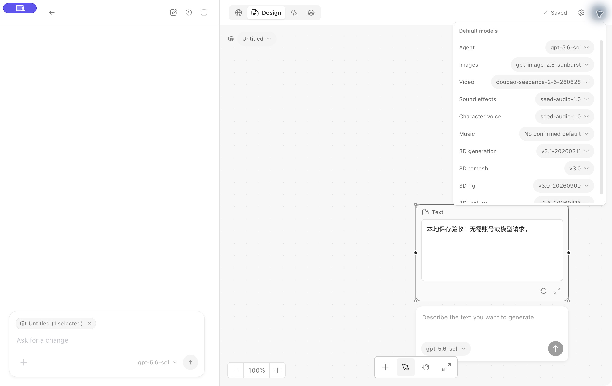
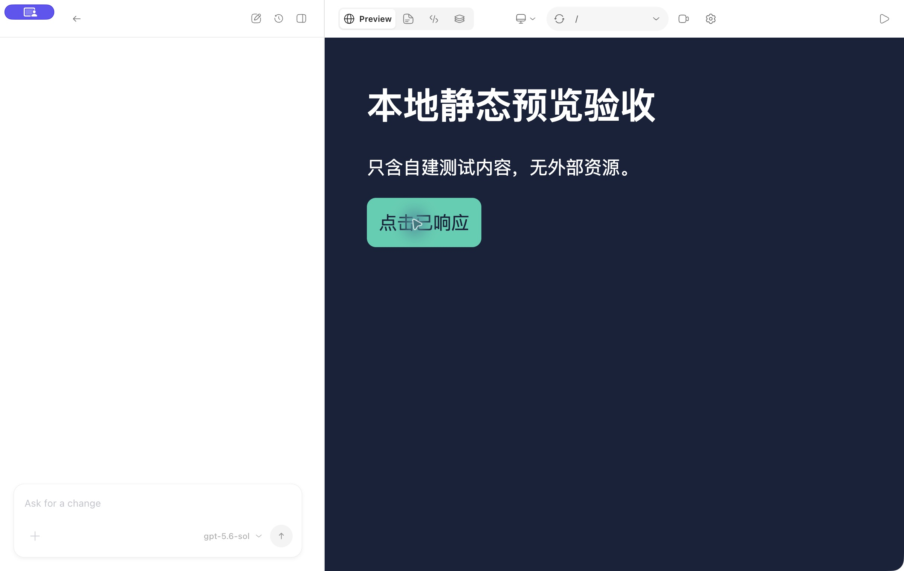
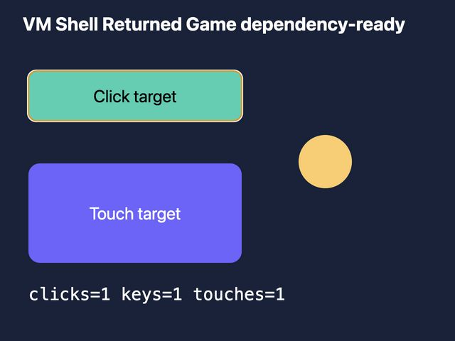

# 人工验收前检查记录（2026-10-28）

**结论：当前受限本地源码版可以进入人工验收。** 本轮发现的确定回归已修复并复测，自动检查通过；这不是“绝对安全”或“没有任何 bug”的保证。真实 Kunpo 权限、产物质量、费用和未接入功能不能用模拟请求替代验收。

基线 HEAD 仍为 `42d7e21e396d9adef7a79081416d9cf3b1a97663`。保留之前未提交成果，没有 reset、commit、push、发行打包、系统安全设置变更或完整工作区备份。本轮没有读取/配置用户真实 Key，没有真实模型或付费请求。

## 交付入口

- 项目根 `.env`：新建的空模板，`KUNPO_API_KEY=`，232 字节，0600，仅当前用户读写。
- 根目录 `启动 OhMyGame.command`、`停止 OhMyGame.command`：0700。实际 Finder 双击启动已成功；重复启动只唤起同一实例，重复停止安全返回。
- [启动说明及人工测试清单](manual-acceptance.md)：包含七类模型工作、取消/未知结果/恢复、成本和停止条件。
- [型号与协议范围](kunpo-local.md)：默认值、可选项、待接入项；本文最终统计取代其中早先选定测试数，不能相加。

启动项使用本项目核验的 Node 22.23.4、Electron 43.3.0。核对官方归档及 5025 个运行时文件后放入 `.runtime/toolchain`，没有新增下载；不替换全局工具。Electron 开发运行不等于 exe/dmg 发行打包；归档完整性检查也不冒充发行签名认证。

## 本轮修复

1. **引导与无 Key 本地工作流**：防重复提交；移除退役凭据的旧接线。空 Key 可创建、打开本地项目及会话，保留模型选择；发消息仍明确要求配置 Key。修复异步失败时 ProjectShell 条件提前返回造成的 React Hooks 错误。
2. **敏感数据出口**：已登记 Key 在工具入参、源码阅读、请求正文、错误/日志、原始文件、静态预览、封面、缩略图、插件图标、ZIP 和应用内 Library 的交付前检查。二进制使用不可变快照，覆盖先入库后登记 Key 及检查后换源文件；不先发送再扫描。
3. **凭据启动链**：显式、严格的 `.env` 字面量解析；不 source/eval、不插值。只有 daemon 读取指定文件，重启复用独立私有快照；Vite 禁用 envDir。桌面创建 daemon 前剔除继承凭据和运行时注入变量，修复父 IPC 在认证期断开竞态。
4. **双击控制器**：固定工具路径、跳过用户 Shell 启动配置，核验运行时；处理首次目录、FIFO、链接/硬链接、重复启动、停止和异常所有权回收。启动不自动安装依赖或提交模型请求。
5. **退出与 VM**：修复活跃 SSE 阻止 Fastify 关闭的互等。先拒绝新请求、结束事件流、取消 Agent/任务及预览，再关闭 VM；清理失败仍继续其余清理并汇总错误。本次正常桌面退出实际记录 daemon `exit 0`，VM `Stopped`，回执与控制锁消失。
6. **嵌套启动目录**：依赖审锁、VM 工作目录、node_modules 保留、构建和产物回传使用同一所选子目录。没有给测试项目补根 package.json。来宾两个控制脚本固定 SHA 校验后部署，仍保持原有硬配额、离线任务及源码回传边界。

原作者登录、Cloud/Community、遥测、更新、上传与 sourcemap 上传继续退役，没有恢复环境变量重新开启路径。manifest/lock 的 dependencies、devDependencies、optionalDependencies、peerDependencies、overrides、patchedDependencies 六类字段一致；许可证与必要版权保留。

## 最终验证

| 检查 | 本轮最终结果 |
| --- | --- |
| 整仓 TypeScript `--noEmit` | 退出 0 |
| 全仓 Vitest，Node、threads 1 | 354 文件：346 通过、8 既有跳过；4101 用例：3911 通过、0 失败、190 既有跳过；退出 0 |
| 来宾 Python | storage 6、controller 4，通过；与 Vitest 不相加 |
| host / story / renderer / sandbox / player 构建 | 六步全部退出 0，正常启动器记录构建指纹；没有发行打包 |
| manifest/lock、差分空白检查 | 通过 |

190 项未执行是 179 项退役 CLI/MCP/插件/远端发布成功契约、9 项 Windows 专属、2 项可选 Blender 集成。它们不计通过；本轮未用新增 skip 或放宽执行断言消除失败，退役入口另有实际拒绝且零外联/零执行测试。早期诊断轮失败数和各子模块通过数不能与最终全仓结果相加。

真实界面检查：空 Key 引导跳过、项目创建/打开、唯一测试文件创建、设计画布文字编辑自动保存、离开重开保留、模型分组弹层及关闭、静态预览点击响应、Finder 启动、重复启动、停止与重复停止。原有 Code 面板是查看器，不冒充新内嵌代码编辑器。800px 网页模型菜单已有前批证据，本轮原生桌面保留 960×640 最小窗口限制；不声称本轮重做所有尺寸和所有模型组合。

真实执行检查：

- 本机假模型经实际 Pi Agent 调用 isolated_shell，安全回传源码，再用缓存 `is-number@7.0.0` 完成构建、动态预览；Electron game_use 实际 open→click→key→touch→capture→close。截图显示三项计数均为 1，图像也进入后续 Pi 请求。8 次请求全部到本机 mock，17 份公共日志/状态/测试源文件无假 Key；私有凭据文件 0600。没有把人工点击算成自动 Agent 试玩。
- 当前最终正常启动项按需启动专用 VM，所选嵌套 npm 包实际预览成功。随后独立测试控制器在前一所有者结束后取得新租约，用同一嵌套包和缓存锁定依赖构建，返回 `dynamic-fixture-20261028/dist` 并导出 488 字节测试 ZIP；根目录无 package.json。并发的第二控制器曾被现有租约正确拒绝，没有绕过租约。
- 真正本机 SSE 关闭测试主动 EOF、活动 Agent abort、新工作拒绝；清理错误继续执行并抛 AggregateError。正常 Electron 退出的实际日志为 `OhMyGame service exited (0)`。专用 VM 最后 `Stopped`，本批控制器和 VM 租约均已清除。

## 外联观察和安全边界

Agent/Electron 闭环观测窗口为 **06:07:46.200–06:11:12.378 UTC**：57 条 Node 事件、134 次 Chromium 请求回调，HTTP 主机仅 127.0.0.1；非 loopback/作者请求尝试记录为 0。另对正常启动器及子进程在 **06:01:27.832–06:04:27.174 UTC** 采集 88 次套接字快照，只见 loopback。这些分别是进程内拦截/记录与套接字抽样，不是全机抓包；不能证明短暂原生连接、OS、其他应用、供应商私有后台或未审依赖绝对安全。没有主动向作者域名发送验证请求。

原始项目文件/静态预览单文件 64MiB，Library 单素材 200MiB，ZIP 单条 128MiB、未压缩合计 512MiB/10,000 条；检查会使用相应快照内存，超限明确拒绝。已知值检查不是任意秘密/编码识别器。同 UID 应用仍可能读取 0600 文件；当前凭据快照不是钥匙串加密。只有受审专用启动链包含在 `.env` 不进入界面/任务环境的证明范围，普通开发者 Bun 命令可能自行加载 `.env`。

通用宿主 Shell、外部 CLI/MCP/插件和原生引擎执行仍关闭；game_use 本来就只支持 Web。完整音乐无确认默认，SeedAudio 精确朗读/音色和字幕未实测，视频未接通的编辑/延长等不提供可用假象。真实模型费率/权限、模型质量及全部组合需人工选择性验收。

## 清理与证据

只将两份确认不用的旧自建预览目录通过 Finder 移入废纸篓，可恢复，未清空：`ohmygame-preview-QX9z2h`（8KiB）、`ohmygame-preview-OA9xQD`（16KiB）。它们已移出工程；不宣称释放了废纸篓所占磁盘。清单见 [cleanup-20261028.json](assets/cleanup-20261028.json)。保留源码、许可证、必要文档、运行时、依赖、dist、官方核验归档和历史测试证据；没有永久清理用户数据或复制工作区。

保留磁盘记录：专用 Node/Electron 494,572KiB，VM/来宾/归档/证据 3,180,784KiB，两项约 3.51GiB，低于 14GiB 运行时预算；node_modules 695,820KiB、dist 15,060KiB。运行配置仍为 2vCPU/4GiB。

本机证据：

- 最终全仓命令、日志和 JSON：`/private/tmp/ohmygame-preacceptance-complete-bo6k8zla/`。
- 最终类型/README/启动器补检：`/tmp/ohmygame-final-doc-launcher-check.log`。
- 正常启动、VM 部署/关闭、嵌套构建和最终统计：`.runtime/local-launch/acceptance/`；当前构建指纹：`.runtime/local-launch/build.json`。
- 实际 Agent/自动试玩：`.runtime/local-execution/acceptance-final-nqgzpt_a/acceptance-summary.zh-CN.md`、`acceptance-result.json`、`job-cleanup.json`、`final-cleanup.json`。本批 4 个任务与 4 个控制器均无 PID/cgroup，状态中有 failed，不冒充全部 unit 成功。
- 新 UI/试玩截图见下方；没有真实账号或 Key。

工具限制已安全处理：Terminal 窗口读取被工具策略拒绝，未改用其他 UI 技术绕过；通过受支持执行通道和项目自身日志验证，实际 Finder 启动仍已完成。一次创建 index.html 被自动审批误判作覆盖仓库根入口而拒绝；改用唯一文件名和新自建子目录，没有覆盖该入口。没有待批准的危险动作。

ChatGPT Library 上传此前不可用，本轮按要求未反复重试；交付在本机，不猜附件 ID 或私有下载地址。

## 主窗口红叉退出追加（2026-10-28）

按用户要求，主窗口红叉现在共用 CmdQ 的 before-quit 保存/清理流程。重复 close/quit 共用同一次保存和清理；保存失败或超时保留窗口供重试，不强行丢弃。只有主窗口触发完整退出，普通 Play 子窗关闭和 Agent 试玩子窗隐藏的原语义保持。停止脚本保留为备用入口；VM 所有权规则未改。

本次针对性测试为 6 文件、53 项通过、0 跳过，类型检查与 host 构建退出 0；没有重跑整仓。上文 3911 项是此前完整检查的历史统计，不与 53 相加。

独立临时 HOME、空 fake.env、临时应用数据的真实 Electron 验收：实际点主窗口红叉后 Electron exit 0、daemon exit 0，画布测试文字确认落盘；测试 daemon 使用真实 IsolatedProjectExecution/VM 生命周期构件的受控注入，仅为验证清理，不读取用户存储、不新增生产配置入口。它拥有的既有专用 VM 最后 Stopped、租约移除。实际点 Agent 试玩子窗红叉后窗口隐藏、会话仍在，主窗口保留；普通 Play 子窗关闭后本机认证 health 仍 200；⌘Q 再次退出 0。保存失败、超时、并发 close/quit 与重复关闭由目标单测覆盖，没有制造真实磁盘故障。

证据：`/private/tmp/ohmygame-red-close-y4uum9a9/` 的 `tests-final.json`、`typecheck.log`、`host-build.log`，以及 `red-vm/{result.json,save-check.json,events.ndjson}`、`cmdq/{result.json,child-close-health.json,events.ndjson}`。本轮未读取或改写根 .env，未使用正常启动器加载凭据，未调用模型；全部测试进程已结束。
